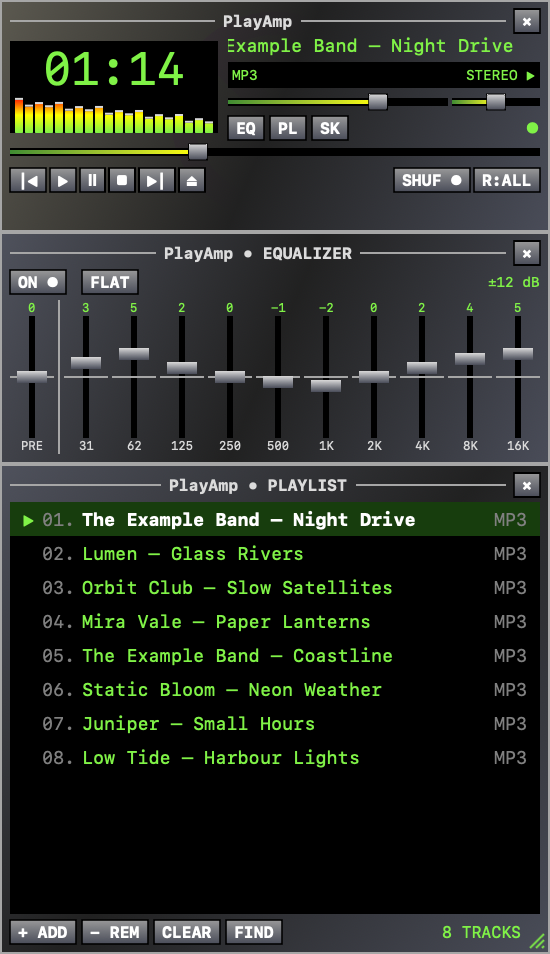
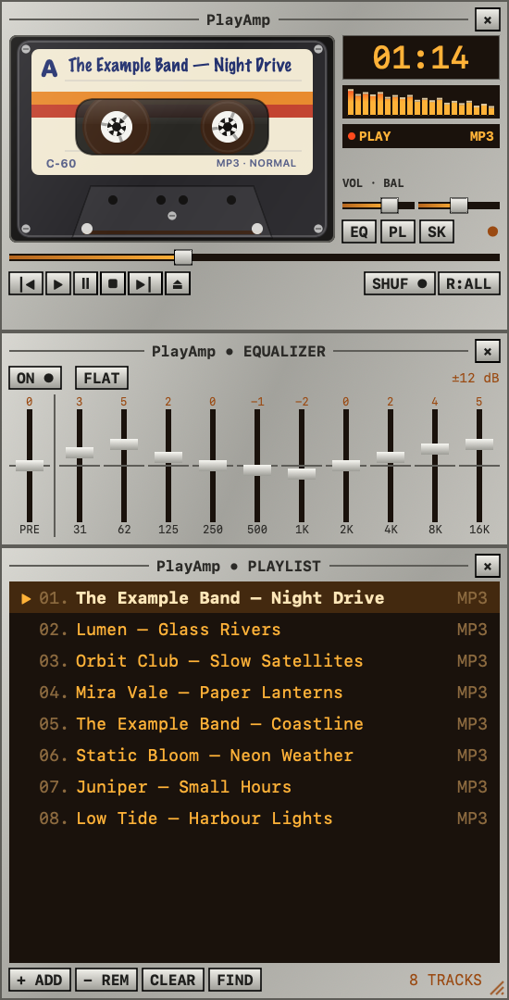
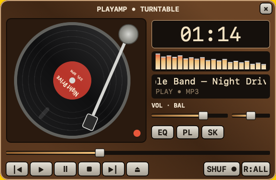
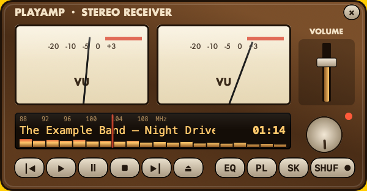
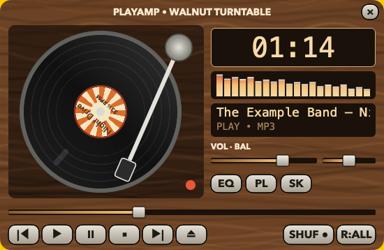
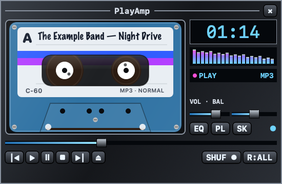

<p align="center"></p>

<h1 align="center">PlayAmp</h1>

<p align="center">A native, offline Mac music player with the feel of a late-90s desktop player:<br>
three tiny snap-together windows, a spectrum analyzer, a ten-band equalizer and swappable skins.</p>

<p align="center">
  
  &nbsp;&nbsp;
  
</p>

PlayAmp plays your local music files: no accounts, no streaming, no library import. Drop files or folders on it and press play. It's written in Swift with SwiftUI and AppKit, and uses [SFBAudioEngine](https://github.com/sbooth/SFBAudioEngine) for decoding.

> PlayAmp is an independent, original project inspired by the desktop music players of the late 1990s. All code, artwork and skins are its own, and it is not affiliated with any other player or company.

## Contents

- [Features](#features)
- [Install and run](#install-and-run)
- [Using PlayAmp](#using-playamp)
- [Skins](#skins)
- [Development](#development)
- [License](#license)

## Features

- **Three retro windows**: player, playlist and equalizer, at 1×, 2× or 3× size.
- **Magnetic docking**: drag the playlist or equalizer near any edge of another window and it snaps into place. Move the player and every attached window moves with it. Windows also snap to screen edges and never slide under the menu bar.
- **Formats**: WAV, MP3, FLAC, AAC/M4A, AIFF, Ogg Vorbis and Opus.
- **Spectrum analyzer** with the classic motion: bars jump on the beat, fall back smoothly, and peak markers hold for a moment before dropping.
- **Ten-band equalizer** (31 Hz–16 kHz) with preamp and automatic headroom, plus volume and balance.
- **Playlist** with drag-to-reorder, search (⌘F or J), shuffle without repeats, repeat off/all/one, and auto-scroll to the playing track.
- **Notch player**: rest the pointer on the MacBook's camera notch and a small player drops out of it, with the song, a live spectrum, a seek bar and controls. Works even while PlayAmp is hidden or minimized.
- **Media keys and Control Center**: play/pause, next, previous and scrubbing from the keyboard or the Now Playing widget.
- **Skins that can look like anything**: recolor in a few lines, add textures, fonts and artwork, or design a completely new player in JSON with parts that move to the music (spinning records, tonearms, VU needles). Built in: Classic, an animated Cassette Deck, and a Turntable. There's also an [AI skill](skills/playamp-skins/SKILL.md) for building skins with an LLM.
- **Picks up where you left off**: queue, position, EQ, volume, skin and window layout are restored at launch, without auto-playing.
- **Private and light**: sandboxed with read-only access to the files you choose; uses about 0.2% CPU when idle.

## Install and run

### Download (easiest)

1. Download `PlayAmp-<version>-macOS-arm64.zip` from the [latest release](https://github.com/allexcd/PlayAmp/releases/latest) and double-click it to unzip.
2. Drag **PlayAmp.app** into your **Applications** folder.
3. Open it. The app isn't notarized by Apple yet, so the first launch is blocked with a warning. Click **Done**, then go to **System Settings → Privacy & Security**, scroll down and click **Open Anyway** next to the PlayAmp message. You only need to do this once.

Prefer the Terminal? This clears the download flag instead:

```bash
xattr -dr com.apple.quarantine /Applications/PlayAmp.app
```

Needs a Mac with **Apple Silicon** (M1 or newer) and **macOS 15** (Sequoia) or newer.

### Build from source

Requirements: Apple Silicon, macOS 15 or newer, and **Xcode 16** or newer (installed from the App Store and opened once so it can finish setting up).

```bash
git clone https://github.com/allexcd/PlayAmp.git
```

```bash
cd PlayAmp
```

```bash
./scripts/build-app.sh
```

```bash
open dist/PlayAmp.app
```

The first build downloads the codec libraries (pinned in `Package.resolved`); later builds work offline. The result, `dist/PlayAmp.app`, is a self-contained app. Drag it into `/Applications` if you want to keep it.

The app is signed only for the Mac that built it. If you copy it to another Mac, allow it once with **Open Anyway** as described in the download steps.

### Run from Xcode

Open `PlayAmp.xcodeproj`, pick the **PlayAmp** scheme and press **Run** (⌘R). Xcode embeds and signs the codec frameworks for you.

## Using PlayAmp

### Adding music

- Press **⌘O** or the **⏏** button and pick files or folders, or
- drag files or folders onto the player or playlist.

Folders are scanned recursively (hidden files and symlinks are skipped). PlayAmp never copies, changes or deletes your audio files; removing a track only removes it from the queue.

### Coming from Mac-Amp?

PlayAmp was called Mac-Amp up to version 0.3.2. Because the app's identity changed, PlayAmp starts with an empty playlist and default settings. To bring your skins and settings across, quit both apps and run:

```bash
cp -R ~/Library/Containers/dev.macamp.prototype/Data/Library/Application\ Support/MacAmp/. ~/Library/Containers/com.allexcd.playamp/Data/Library/Application\ Support/PlayAmp/
```

Open PlayAmp once before running it, so its folder exists. If tracks then fail with a permission message, remove them and add your music folder again: macOS grants file access per app.

### The windows

| Window | What it does |
|---|---|
| **Player** | Time display (click to switch elapsed/remaining), spectrum, title, volume and balance, seek bar, transport buttons, shuffle and repeat. **EQ**, **PL** and **SK** open the equalizer, playlist and skins panel. The × hides the app; click its Dock icon to bring it back. |
| **Playlist** | Double-click a track to play it. Drag rows to reorder, press Delete or **− REM** to remove, right-click for Play/Remove. **FIND** searches by title or artist. |
| **Equalizer** | Preamp plus ten bands of ±12 dB. **ON/OFF** bypasses it, **FLAT** resets every band. |
| **Skins** | Lists every skin with a preview; click one to switch. |

### The notch player

On a MacBook with a camera notch, rest the pointer on the notch for a moment and a black mini player grows out of it: song and artist, a spinning record, the spectrum, a seek bar you can drag, and shuffle, previous, play/pause and next buttons. The window button brings the full player back. Move the pointer away and it tucks back into the notch. It stays available while PlayAmp is hidden or minimized, and takes its accent colors from the current skin.

On Macs without a notch, the same hover spot sits at the top centre of the main screen. Turn it off with **View → Notch Player**.

### Moving and docking windows

Drag the striped grip in the bottom-right corner of the playlist or skins panel up or down to change its height. Windows docked below move with it, and the size is remembered.

Drag any window by its title bar. Bring a panel within about 24 points of another window's edge and it snaps there; drag it away to detach it.

### Keyboard shortcuts

| Keys | Action |
|---|---|
| Space | Play / pause |
| ⌘. | Stop |
| ⌘[ / ⌘] | Previous / next track |
| ⌘O | Add files or folders |
| ⌘F or J | Search the playlist (Enter plays the first match, Esc closes) |
| ⌘L / ⌘E / ⌘K | Show or hide the playlist / equalizer / skins panel |
| ⌘1 / ⌘2 / ⌘3 | Original, double or triple size |
| ⌥⌘1, ⌥⌘2, … | Switch to skin 1, 2, … |
| ⌘0 | Bring back the player |
| ⌘M | Minimize the player |
| Media keys | Play/pause, next, previous |

### Where your settings live

PlayAmp is sandboxed, so its data lives in its container:

```
~/Library/Containers/com.allexcd.playamp/Data/Library/Application Support/PlayAmp/
├── session.json   queue, position, EQ, volume, skin, visibility
└── Skins/         your custom skins
```

Window positions are stored in the app's preferences. Delete the `PlayAmp` folder to start fresh.

## Skins

<p align="center">
  
  
  
  
</p>

Open the Skins panel with **SK** on the player (or **⌘K**) and click a skin to switch. Built in:

- **Classic**: gunmetal panels and a green phosphor display.
- **Cassette Deck**: a silver 70s tape deck. The label shows the song title in handwriting, and the reels turn and wind from spool to spool as the song plays.
- **Turntable**: a walnut record player. The record spins at 33⅓ rpm and the tonearm tracks across it as the song progresses. It's drawn entirely from a JSON layout, the same format your own skins use.

Press **FOLDER** in the Skins panel to open your skins folder. That also installs three examples: **VU Radio** (a receiver with VU needles that follow the music, a tuning dial you drag to seek, and a spinning knob), **Walnut Turntable** (wood textures, printed label art and different fonts) and **Midnight Tape** (colors only).

### Make your own

A skin is JSON. It can be a single `.json` file, or a folder with `skin.json` plus its images and fonts. Anything you leave out comes from the skin named in `basedOn`, then from Classic, so you only write what changes. There are three levels:

**1. Recolor** an existing design:

```json
{ "name": "Ice", "basedOn": "cassette",
  "colors": { "display": "#7FD0FF", "cassetteShell": "#BFE6FFB0", "panelTop": "#DCE9F2" } }
```

**2. Add images, fonts and shape options** (folder skins):

```json
{ "name": "Walnut", "basedOn": "turntable",
  "images": { "panel": { "file": "wood.png", "mode": "tile" }, "recordLabel": "label.png" },
  "fonts": { "display": "Menlo", "label": "Futura" },
  "shape": { "windowCorner": 12, "buttonCorner": 5 } }
```

**3. Design a whole new player** with a `layout`: a size plus a list of elements (rectangles, ellipses, images, text, a spectrum, buttons, sliders, drag areas and groups). Any number can follow playback, so parts can spin, swing or light up:

```json
"layout": { "size": [300, 156], "elements": [
  { "type": "rect", "frame": [0, 0, 300, 156], "corner": 10, "fill": "panelMid" },
  { "type": "dragArea", "frame": [0, 0, 280, 18] },
  { "type": "group", "frame": [12, 20, 110, 66], "pivot": [55, 76],
    "rotation": { "bind": "level", "from": -42, "to": 40 },
    "children": [ { "type": "rect", "frame": [54, 10, 2, 56], "fill": "#1B1B1B" } ] },
  { "type": "text", "frame": [180, 101, 54, 11], "text": "{time}", "font": "display" },
  { "type": "button", "frame": [38, 129, 24, 16], "action": "playPause", "label": "▶" } ] }
```

After editing, press **RELOAD** in the Skins panel.

### Skins from other people

A skin is only data: colors, pictures, fonts and a description of shapes. It can't run code. PlayAmp also treats skin files as untrusted:

- A skin can only use files inside its own folder. Absolute paths, `..` and symlinks that lead elsewhere are refused.
- Sizes and counts are limited (window size, number of elements, picture dimensions), so a broken or hostile skin can't hang the app or fill the screen.
- If a skin ever stops PlayAmp from opening properly, hold **Option** while launching it to go back to the Classic skin.

### Check and preview skins without opening the app

The app's executable doubles as a skin tool:

```bash
PlayAmp --validate-skin "My Skin"
```

```bash
PlayAmp --render-skin "My Skin" --window all --state playing --progress 0.4
```

```bash
PlayAmp --skin-reference
```

`--validate-skin` explains each problem with its exact location, `--render-skin` writes a preview image, and `--skin-reference` prints every color, image slot, font role, element type, binding, placeholder and action.

`PlayAmp` here is `/Applications/PlayAmp.app/Contents/MacOS/PlayAmp`, or `swift run PlayAmp` in a source checkout. The installed app is sandboxed, so it can only read skins in its own Skins folder: `~/Library/Containers/com.allexcd.playamp/Data/Library/Application Support/PlayAmp/Skins`.

### Build skins with an AI assistant

[`skills/playamp-skins`](skills/playamp-skins) is a skill that teaches an LLM to design PlayAmp skins: a workflow (brief → JSON and images → validate → preview → iterate), recipes for common effects, working examples, and a full [reference](skills/playamp-skins/reference.md) generated from the code.

- **Claude Code:** copy the folder to `~/.claude/skills/`, then ask something like "make me a PlayAmp skin that looks like a 1980s boombox".
- **Other assistants:** give them `SKILL.md` and `reference.md`.

## Development

### Project layout

```
Sources/
  PlayAmpCore/         Pure logic, no UI (unit-tested)
    Session.swift        Saved state, queue, shuffle/repeat decisions, JSON persistence
    WindowDocking.swift  Snapping and "which windows are attached" math
    Skin.swift           Skin format, built-in skins, loading and inheritance
    SkinLayout.swift     Layout format (elements, paints, bindings) and the skin validator
    BuiltInLayouts.swift  The Turntable, written in the layout JSON format
  PlayAmp/             The app
    App.swift            Windows (creation, dragging, docking), menus, app delegate
    Model.swift          Observable app state, playback control, import, Now Playing
    Playback.swift       Audio engine, equalizer, spectrum analysis
    Views.swift          Player, playlist and equalizer views, shared controls
    Cassette.swift       The cassette player face and its animated tape
    SkinsPanel.swift     The Skins window
    Layout.swift         Draws layout skins: elements, live bindings, actions, sliders
    SkinTool.swift       --validate-skin, --render-skin and --skin-reference
    Theme.swift          Turns a skin into SwiftUI colors, images, fonts and shapes (the "palette")
skills/playamp-skins/  AI skill for designing skins, its reference and example skins
Vendor/SFBAudioEngine/ Trimmed copy of the audio engine (see its VENDORED.md)
Tests/                 Unit and playback tests
scripts/               Build, packaging, fixtures, project and icon generation
Config/                Info.plist, entitlements, app icon
```

### How it fits together

- Each window is a borderless `NSWindow` hosting a SwiftUI view. `Windows` in `App.swift` moves windows itself on title-bar drags. That's what lets attached panels follow every mouse step and snap live.
- `Model` is the single source of truth. Values that change many times a second (position, play state) live in a separate `LiveState` object that only the player watches, so the playlist and equalizer don't redraw on every tick.
- `Playback` wraps SFBAudioEngine's `AudioPlayer`, inserts an `AVAudioUnitEQ`, and taps the output for the spectrum. Analysis runs off the main thread, and its frames are released in step with the audio so the bars animate smoothly at 60 fps.
- Skins flow through the SwiftUI environment as a `Palette`. Views ask it for colors, images and fonts by name instead of hard-coding them. A skin with a `layout` replaces the player's view with `LayoutCanvas`, which reads a `LayoutState` (bindings, text, actions) that doesn't depend on `Model`. That's how `--render-skin` can draw previews with sample data.

### Build and test from the command line

```bash
swift build
```

The tests decode and play short generated tones, so create those first (needs [ffmpeg](https://ffmpeg.org), e.g. `brew install ffmpeg`):

```bash
./scripts/generate-fixtures.sh
```

```bash
swift test
```

Playback tests briefly play quiet tones and need an audio output device; they and the codec tests rely on the fixtures above.

`swift run` works for quick UI iteration, but it runs unsandboxed and without the app bundle (generic Dock icon, settings stored outside the sandbox container). Use `./scripts/build-app.sh` or Xcode to try the real app.

### Handy scripts

| Script | Use it when |
|---|---|
| `scripts/build-app.sh` | Building `dist/PlayAmp.app` (release build, codec frameworks embedded, licenses copied, signed). |
| `scripts/generate-project.py` | **You add or remove a source file.** The Xcode project lists files explicitly and is generated from the `Sources/` folders. |
| `scripts/make-icon.swift` | Changing the app icon. It draws the icon in code and writes `Config/AppIcon.icns`: `swift scripts/make-icon.swift`. |
| `scripts/generate-fixtures.sh` | Creating the test audio files. |
| `scripts/make-example-assets.swift` | Regenerating the example skins' images (wood textures, record label). |

### Good first changes

- **A new skin or player design**: try it as a JSON skin first (see [Skins](#skins)). Most designs need no Swift at all. To make one built in, add its layout to `BuiltInLayouts.swift` and a `Skin` to `Skin.builtIn`, as the Turntable does.
- **A new layout element, binding or action**: add it to the lists in `SkinLayout.swift` (so the validator and reference know it), draw it in `LayoutRenderer`, then regenerate `skills/playamp-skins/reference.md` with `--skin-reference`. A test fails if you forget.
- **A new window**: add a case to `Windows.Panel`, its size in `update(_:)`, and its view; docking and snapping come for free.

### Not done yet

Named playlists, M3U import/export, library indexing, streaming, guaranteed gapless playback, and automatic updates. Testing has been on recent macOS; macOS 15, other output devices, and VoiceOver need more checking.

## License

PlayAmp's own code is released under the [MIT License](LICENSE).

Everything it's built from is under permissive licenses, with no LGPL or GPL code:

- A trimmed copy of [SFBAudioEngine](https://github.com/sbooth/SFBAudioEngine) (MIT) in [`Vendor/SFBAudioEngine`](Vendor/SFBAudioEngine/VENDORED.md), keeping only the player and the decoders the app uses.
- The Xiph libraries for Ogg Vorbis, Opus and FLAC (BSD).
- MP3, WAV, AIFF, AAC and M4A are decoded by macOS itself.

The notices are in [`Licenses/`](Licenses) and [`THIRD_PARTY_NOTICES.md`](THIRD_PARTY_NOTICES.md), and ship inside the app.
